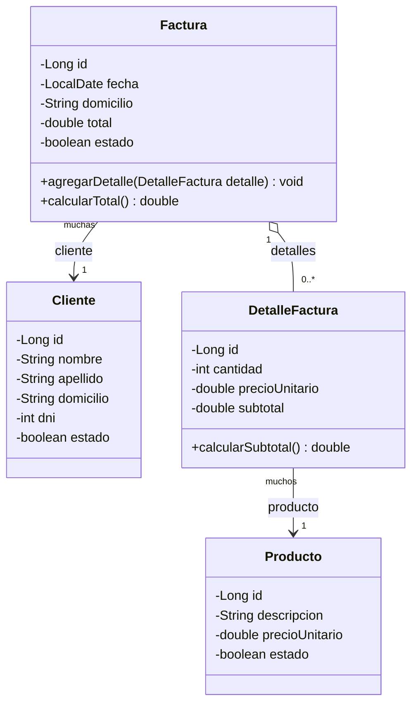

# Diagrama de clases

Modelo de clases y relaciones del problema: el registro de una **factura**
resultado de la venta de **productos** a un **cliente**. GitHub renderiza el
diagrama automáticamente.

## Relaciones

- **Factura → Cliente** (`@ManyToOne`): muchas facturas pueden pertenecer a un
  mismo cliente. La entidad **propietaria** es `Factura` (tiene la clave foránea
  `cli_id`).
- **Factura → DetalleFactura** (`@OneToMany(mappedBy = "factura")`): una factura
  está compuesta por muchos detalles. La relación es **bidireccional** y el lado
  propietario es `DetalleFactura`. Usa `CascadeType.ALL`, por lo que al guardar
  una factura se guardan también sus detalles, y `FetchType.EAGER` para traerlos
  junto con la factura.
- **DetalleFactura → Producto** (`@ManyToOne`): cada detalle hace referencia a un
  producto. La entidad propietaria es `DetalleFactura` (tiene la clave foránea
  `prod_id`).

Cada `DetalleFactura` guarda el `precioUnitario` del producto **en el momento de
la venta**, de modo que una factura ya emitida no cambia si después se modifica
el precio del producto. El `subtotal` se calcula como `cantidad * precioUnitario`,
y el `total` de la `Factura` es la suma de los subtotales de sus detalles.
